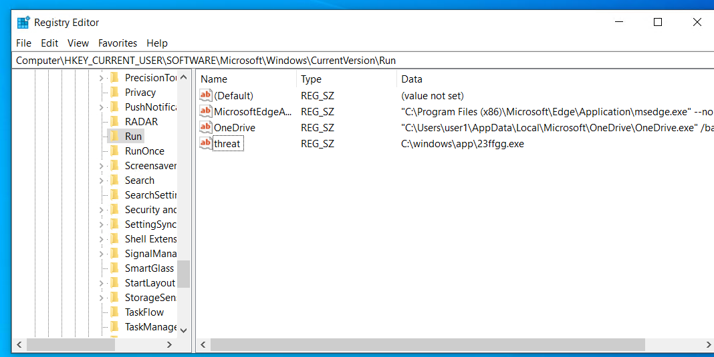
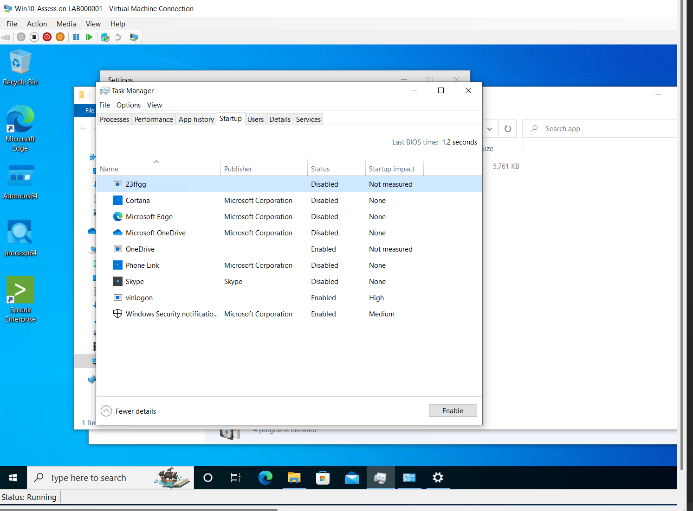
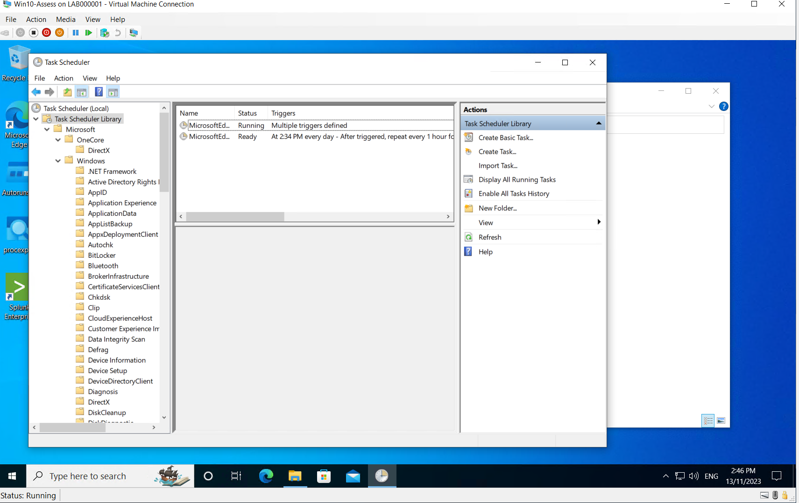
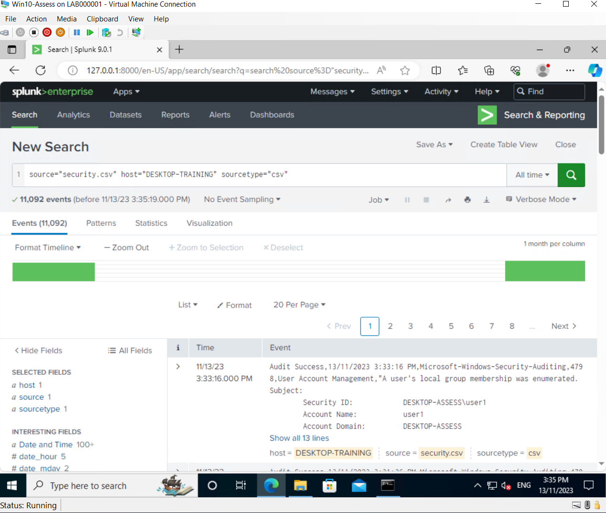
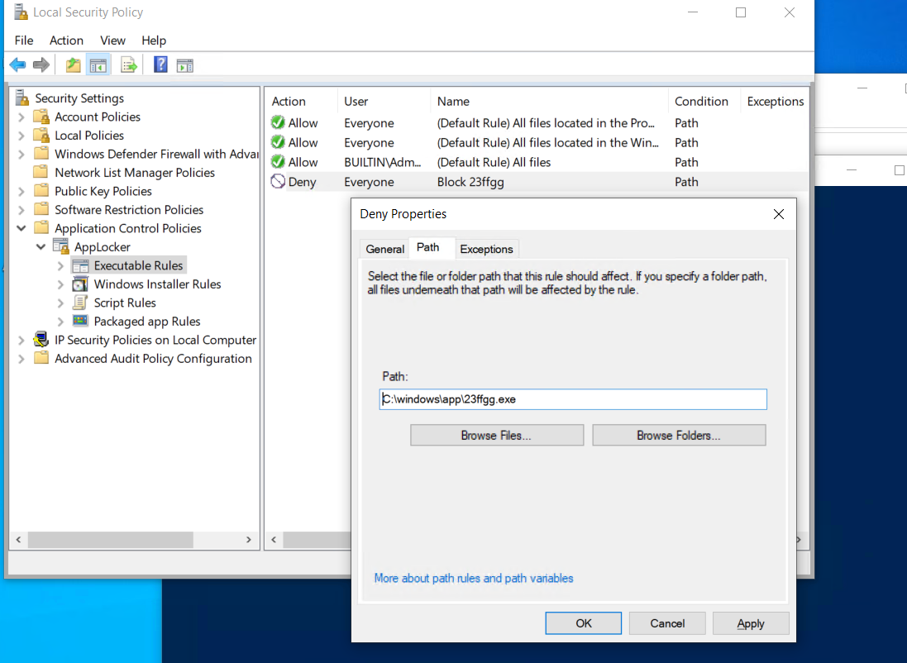
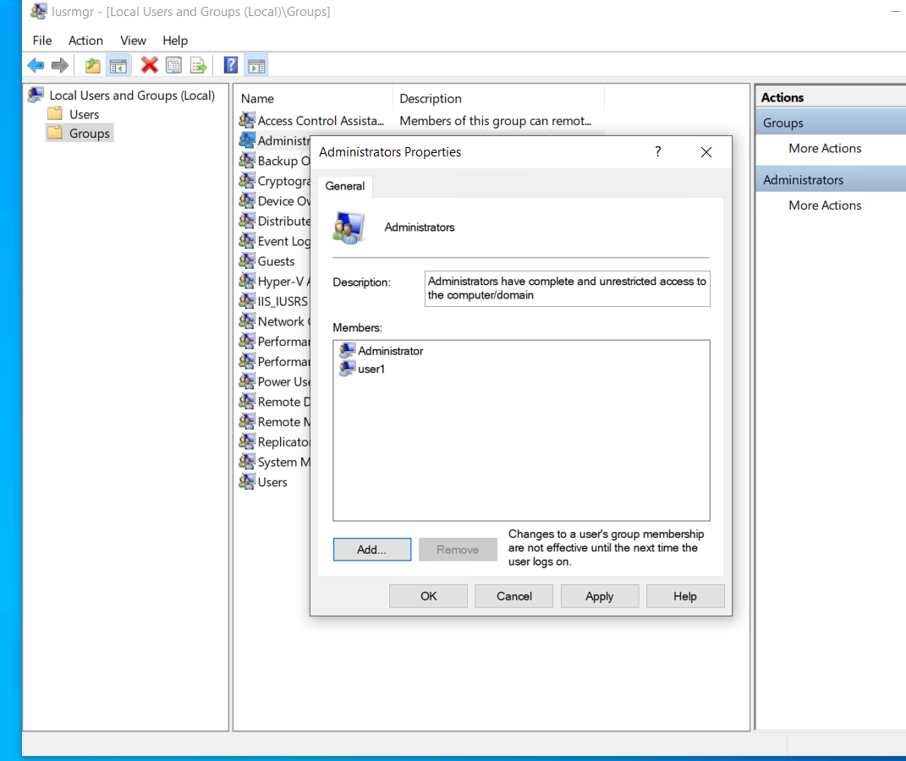
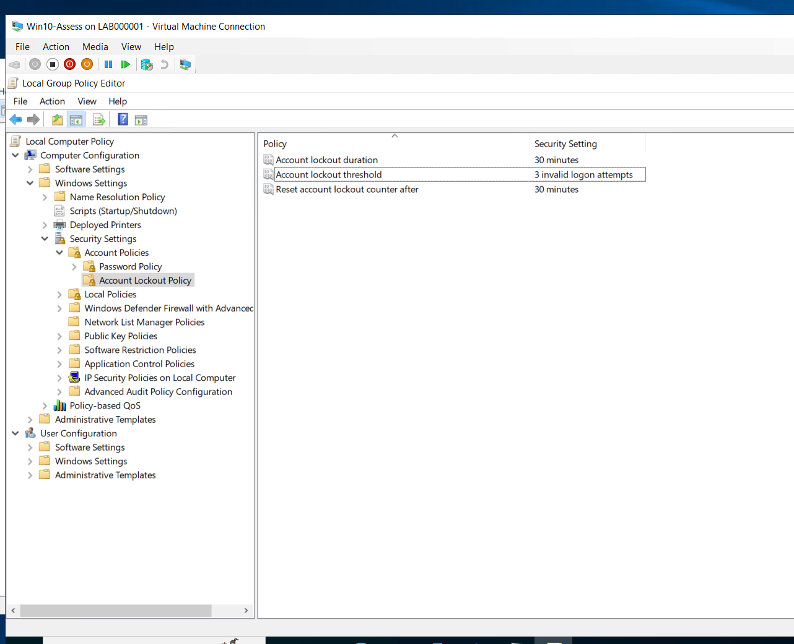

# Windows Threat Hunting & Malware Remediation Lab

Hands-on lab investigating a compromised Windows 10 host: finding and removing
persistent malware, importing the Security event log into Splunk to hunt for
threat indicators, and applying mitigations to prevent recurrence.

> **Outcome:** Removed a persistent malware sample, identified three reliable
> threat indicators in Splunk, and hardened the host against each one.
>
> **Scope:** Isolated lab VM (Windows 10) in Hyper-V. All activity was performed
> against a training machine I was authorised to use.

## What this project demonstrates

- Malware persistence analysis and removal (registry, scheduled tasks, startup)
- SIEM log ingestion and searching with Splunk
- Windows Security event log analysis (Event IDs 4624/4625, 4657, 4733)
- Threat hunting and writing up reliable indicators of compromise
- Host hardening: AppLocker, least privilege, account lockout policy

## Tools & technologies

| Tool | Purpose |
|------|---------|
| Windows 10 / Hyper-V | Target host and virtualisation |
| Splunk Enterprise | SIEM — log ingestion and threat hunting |
| Task Scheduler / Registry Editor / Task Manager | Persistence analysis and removal |
| Local Group Policy / AppLocker | Host hardening and mitigation |
| lusrmgr.msc | Local user and group management |

## 1. Remove persistent malware

A simulated malware file (`23ffgg.exe`) was running as a process and set to
re-launch after reboot. I traced and cleared every persistence method:

1. Stopped the running process in Task Manager
2. Disabled its startup entry
3. Removed its scheduled task
4. Deleted its `Run` key from `HKCU\Software\Microsoft\Windows\CurrentVersion\Run`
5. Deleted the file from `C:\windows\app\`
6. Rebooted and confirmed it did not return





## 2. Import the Security log into Splunk

Exported the local Windows Security log and ingested it into Splunk
(~11,000 events) so it could be searched for threat activity.



## 3. Threat hunting — three reliable indicators

Using Splunk search against the imported log, I identified three indicators and
explained why each reliably points to a threat rather than normal activity:

| # | Event ID | Finding | Why it's a threat |
|---|----------|---------|-------------------|
| 1 | 4657 | Registry value modified under the `Run` key, pointing to `C:\windows\app\23ffgg.exe` | An unknown executable writing itself to an auto-run location is a classic persistence technique |
| 2 | 4733 | A member was removed from a security-enabled local group | Unexpected tampering with group membership can indicate an attacker altering account privileges |
| 3 | 4625 | Failed logon (Logon Type 3 — network) | Repeated failed network logons with no legitimate cause suggest a brute-force or credential-guessing attempt |

> **Note on Event 4733:** the lab log showed a *removal* from a group (4733).
> True privilege *escalation* would normally appear as 4732 (a member *added*
> to a group). I've described this as unauthorised group-membership tampering
> rather than escalation.

## 4. Mitigation / hardening

Applied a specific mitigation for each threat:

| Threat | Mitigation |
|--------|-----------|
| Unauthorised registry/executable persistence | AppLocker executable deny rule blocking `C:\windows\app\23ffgg.exe` (application allow-listing) |
| Group-membership tampering | Reviewed local group memberships and applied least-privilege principles |
| Failed logon / brute force | Account lockout policy — lockout after 3 invalid attempts, 30-minute duration |





## Repository structure

```
windows-threat-hunting-lab/
├── README.md
└── screenshots/        # Evidence for each step
```

## Key lessons learned

- Persistence is rarely a single artefact — removing the file alone wasn't
  enough; the Run key and scheduled task had to go too.
- A single failed logon is not evidence of a threat on its own; context (volume,
  timing, logon type) is what makes an indicator reliable.
- Mitigation should map directly to the specific indicator, not be generic.

## Disclaimer

Completed as part of the Certificate IV in Cyber Security (VU23225 – Investigate
Windows Security Features). All work was performed in an isolated, authorised
training lab. No lab credentials or instructor-supplied material are included in
this repository.
